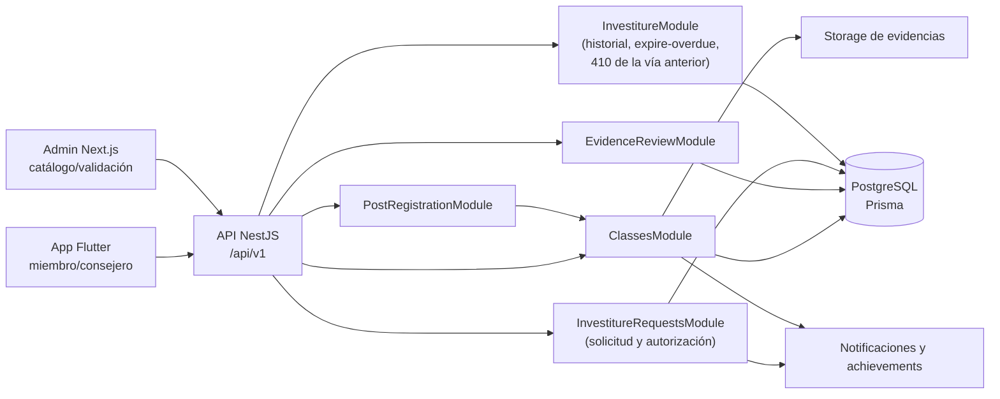
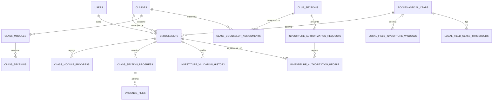
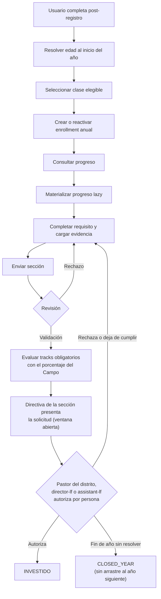
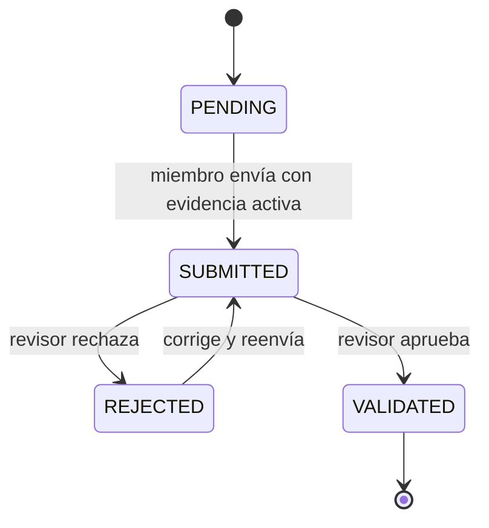
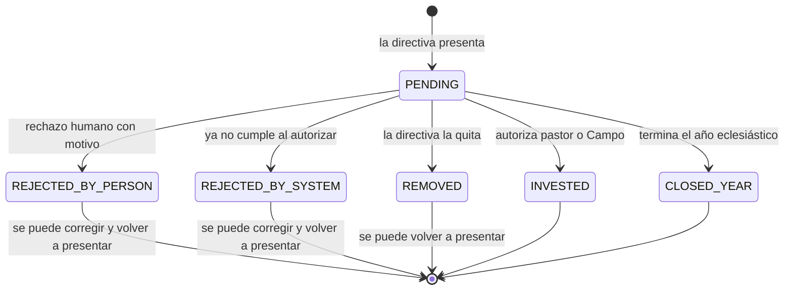

# Clases progresivas — análisis técnico y funcional integral

> **Estado:** diagnóstico con fecha de corte; varias divergencias de la tabla ya figuran como RESUELTO. Verificar contra `development` antes de actuar.
> **Fecha de corte:** 2026-08-11
> **Alcance:** backend NestJS, PostgreSQL/Prisma, app Flutter, panel Next.js y documentación vigente
> **Naturaleza:** documento de diagnóstico; no reemplaza los contratos canónicos
>
> **Actualización de investidura (2026-10-13):** las partes que describían el pipeline club → coordinación → campo (envío a validación, `club-approve`, `coordinator-approve`, `field-approve`, `invest`/`markInvestido`) se reescribieron al modelo vigente en `development`: **investidura por autorización**. La directiva de la sección presenta una solicitud por sección y un pastor del distrito, el `director-lf` o el `assistant-lf` autoriza por persona dentro de la ventana del Campo y con el porcentaje mínimo de la clase. Las 17 rutas de la vía anterior responden HTTP 410 `INVESTITURE_LEGACY_PIPELINE_RETIRED`, la ruta de clase de `ValidationModule` también, y la revisión de evidencia por requisito se mantiene. Fuentes: `docs/features/validacion-investiduras.md` y `docs/plans/2026-09-28-investidura-autorizacion.md`. Mergeado en `development` (backend #465, #466, #468, #469; panel #223 a #226; app #157 a #160). El resto del diagnóstico (fecha de corte 2026-08-11) no se reverificó en esta pasada.

## 1. Resumen ejecutivo

El módulo de clases progresivas administra la trayectoria formativa anual de un miembro: asignación de clase, inscripción, cumplimiento de requisitos, carga y revisión de evidencias, supervisión pedagógica y reconocimiento institucional por autorización hasta la investidura.

La autoridad operativa e histórica es `enrollments`. Cada inscripción vincula usuario, clase y año eclesiástico; el progreso de módulos y secciones se crea de forma perezosa a medida que se consulta o actualiza. El runtime ya soporta requisitos por tracks `BASIC`, `EXTRA` y `ADVANCED`, asignaciones de consejeros, revisión de evidencias y una investidura por autorización con historial auditable (la cadena club → coordinación → campo está retirada).

La base funcional existe, pero hay divergencias que impiden tratar el módulo como cerrado:

1. **Integridad crítica de progreso:** `PATCH /users/:userId/classes/:classId/progress` acepta combinaciones de clase, módulo y sección sin comprobar su relación y no respeta el bloqueo de validación ni estados terminales.
2. **Elegibilidad incorrecta:** una sección con `score >= 70` se considera completada incluso si su evidencia está `REJECTED`.
3. **Invariante anual contradictoria:** el servicio permite hasta dos clases activas de Guías Mayores, pero la base de datos solo permite una inscripción activa por usuario y año.
4. **Deriva de índices de progreso:** Prisma conserva unicidad legacy por usuario/clase, mientras las migraciones intentan introducir unicidad por inscripción; una eliminación usa un nombre que no coincide con el índice real.
5. **Clientes incompletos:** la corrección de evidencia rechazada en mobile contiene un selector de archivos no implementado; admin usa una URL inválida para un historial y no expone toda la configuración curricular ni la expiración manual.

### 1.1 Semáforo de riesgo

| Área | Estado | Motivo principal |
|---|---|---|
| Modelo anual | Ámbar | `enrollments` está consolidado, pero la unicidad DB contradice el límite de Guías Mayores |
| Progreso | Rojo | actualización sin validación relacional ni bloqueo de estado |
| Evidencias | Rojo | un rechazo puede seguir computando como cumplimiento |
| Investidura | Verde/Ámbar | modelo por autorización vigente, vía anterior apagada con 410; depende de una elegibilidad que se corrigió (`REJECTED` ya no cuenta); falta ejecutar el desbloqueo de bloqueos legados en cada entorno |
| Mobile | Ámbar | consulta y operación principal presentes, incluidas las pantallas de presentar y autorizar; corrección de archivo rota |
| Admin | Ámbar | CRUD de catálogo y pantallas de autorización presentes; faltan controles curriculares y de expiración |
| Documentación | Ámbar | hay diferencias de autenticación, UI y modelo respecto del runtime |

## 2. Alcance y criterio de verdad

### 2.1 Incluido

- catálogo de clases, módulos y secciones;
- asignación por edad durante post-registro;
- inscripción anual y progresión entre clases;
- materialización y cálculo de progreso;
- tracks de requisitos y elegibilidad;
- evidencias y su revisión;
- asignación y alcance de consejeros;
- autorización de investidura (solicitud por sección y autorización por persona);
- duración y expiración;
- contratos HTTP y autorización;
- comportamiento efectivo de mobile y admin;
- cobertura de pruebas existente;
- diferencias entre documentación y runtime.

### 2.2 Excluido

- rediseño funcional del programa institucional de clases;
- cambios de código, schema, endpoints o UX;
- ejecución de builds, pruebas o migraciones;
- certificaciones, honores y carpetas salvo cuando participan del flujo de clases.

### 2.3 Precedencia aplicada

Para resolver contradicciones se utilizó esta jerarquía:

1. decisiones canónicas de dominio;
2. código runtime y guards efectivos;
3. schema Prisma y migraciones SQL efectivamente versionadas;
4. pruebas automatizadas como evidencia de intención;
5. documentos de feature y referencias API;
6. clientes mobile/admin como consumidores, no como autoridad contractual.

`docs/canon/decisiones-clave.md` establece que `enrollments` es la fuente única tanto del ciclo anual operativo como de la trayectoria histórica. Cualquier referencia a `users_classes` es legacy.

## 3. Propósito de negocio

El módulo responde cinco preguntas institucionales:

1. **¿Qué clase debe cursar un miembro este año?**
   Se resuelve por edad, tipo de club, disponibilidad anual y trayectoria previa.
2. **¿Qué debe completar?**
   La clase organiza módulos y secciones; cada sección pertenece a un track y puede ser obligatoria para investidura.
3. **¿Quién acompaña y supervisa?**
   Consejeros y secretarios pueden recibir asignaciones pedagógicas; directivos tienen alcance sobre su sección.
4. **¿Qué evidencia demuestra el cumplimiento?**
   El miembro carga archivos, envía la sección y un actor autorizado valida o rechaza.
5. **¿Cuándo se reconoce institucionalmente la clase?**
   Cuando la inscripción cumple requisitos, la directiva de la sección la presenta en una solicitud y un pastor del distrito o el Campo la autoriza dentro de la ventana; el enrollment pasa a `INVESTIDO` sin etapas intermedias.

## 4. Glosario operativo

| Término | Significado efectivo |
|---|---|
| Clase progresiva | Nivel formativo asociado a tipo de club, edad mínima, orden y ventana de años |
| Módulo | Agrupador curricular dentro de una clase |
| Sección/requisito | Unidad evaluable dentro de un módulo |
| Enrollment/inscripción | Autoridad anual que vincula usuario, clase y año eclesiástico |
| Progreso de módulo | Agregado de puntajes/completitud de sus secciones |
| Progreso de sección | Estado y puntaje individual de un requisito |
| Evidencia | Archivo vinculado al progreso de una sección |
| Track | Clasificación curricular: `BASIC`, `EXTRA` o `ADVANCED` |
| Investidura | Reconocimiento institucional que se confirma al autorizar la persona en una solicitud (ya no hay validaciones escalonadas) |
| Solicitud de investidura | Agrupa personas y clases de **una sola sección** que la directiva presentó en la ventana del Campo; cada persona se resuelve por separado |
| Ventana del Campo | Rango de días inclusivos, por Campo local y año eclesiástico, en el que se puede presentar y autorizar |
| Porcentaje del Campo | Umbral mínimo de puntaje por requisito (80 por defecto) que reemplazó el 70 fijo |
| Año eclesiástico | Periodo operativo usado para inscripción, disponibilidad y alcance |
| Scope de progreso | Clases y miembros que un actor puede supervisar según su rol/asignación |

## 5. Actores, roles y responsabilidades

| Actor | Responsabilidad real | Límites relevantes |
|---|---|---|
| Miembro | Consulta clases/progreso, carga, elimina y envía evidencias propias | Requiere permisos y control de ownership; mobile bloquea visualmente expirados |
| Consejero | Supervisa clases asignadas y acompaña el avance del miembro | Para scope pedagógico ve solo clases asignadas; requiere rol elegible. Ya no envía a validación: presentar la solicitud de investidura es de la directiva |
| Secretario | Puede recibir asignación pedagógica y ver la sección según acceso | La asignación exige rol local permitido |
| Director / secretario / secretario-tesorero de la sección | Ven el progreso de toda su sección y presentan, quitan personas y corrigen fechas en la solicitud de investidura de **su** sección | No operan solicitudes de otra sección del mismo club. El subdirector (`deputy-director`) no marca ni lee la solicitud |
| Pastor del distrito | Autoriza o rechaza por persona las solicitudes de su distrito | Rol global `pastor` activo y asignado al distrito del club (cupo global, 2 por defecto); la asignación solo vale dentro de su propio Campo |
| `director-lf` / `assistant-lf` | Autorizan o rechazan en su Campo (basta uno, igual que un pastor); configuran ventana, porcentaje y asignación de pastores | El alcance es el Campo de la solicitud; el porcentaje solo se edita hasta el 30 de junio, después `super-admin` |
| Coordinador | Revisa evidencias por requisito | Rol global. Ya no aprueba etapas de investidura |
| Admin / super-admin | Administran catálogos, revisan evidencias y consultan o configuran ventanas | No autorizan investiduras por esos roles. Solo `super-admin` exacto corre el desbloqueo de bloqueos legados y cambia el cupo de pastores |

## 6. Arquitectura de extremo a extremo

### 6.1 Responsabilidad por componente

| Componente | Responsabilidad |
|---|---|
| `ClassesController` / `ClassesService` | catálogo público, inscripción, progreso y evidencias del miembro |
| `ClassAssignmentResolverService` | clase elegible por edad durante post-registro |
| `ClassRequirementEligibilityService` | aplicación de tracks y elegibilidad para investidura/avanzada |
| `ClassCounselorAssignmentsService` | asignación anual de responsables pedagógicos |
| `ClassProgressScopeService` | visibilidad de clases y miembros según rol/contexto |
| `EvidenceReviewService` | cola, aprobación, rechazo e historial de requisitos |
| `InvestitureService` | solo lo que sobrevive a la fase 8: lectura del historial, `expire-overdue` (duración y expiración) y el desbloqueo de bloqueos legados (`LegacyLockReleaseService`) |
| `LegacyInvestitureRetiredController` | las 17 rutas de la vía anterior, todas HTTP 410 `INVESTITURE_LEGACY_PIPELINE_RETIRED` |
| `InvestitureAuthorizationRequestsController` y servicio (`src/investiture-requests/`) | solicitud por sección, personas, fechas, autorización por persona, historial y anuario; ventana del Campo, porcentaje, cupo y asignación de pastores; correos de presentación y recordatorios; cierre de año sin arrastre |
| Admin Phase E | CRUD de clases, módulos y secciones |
| App Flutter | experiencia del miembro, supervisión pedagógica, presentar solicitud (directiva) y autorizar (pastor / Campo) |
| Admin Next.js | mantenimiento parcial del catálogo y pantallas de autorización, ventana/porcentaje y pastores (`/dashboard/investiture-requests`, `investiture-settings`, `investiture-pastors`) |

## 7. Modelo de datos

### 7.1 Entidades principales

| Entidad | Función | Campos/invariantes clave |
|---|---|---|
| `classes` | catálogo de niveles | `club_type_id`, `minimum_age`, `display_order`, `requires_previous_gm_investiture`, `advanced_enabled`, `available_from_year_id`, `available_until_year_id`, `min_duration_years`, `max_duration_years`, `active` |
| `class_modules` | estructura curricular | clase propietaria, orden, activación y traducciones |
| `class_sections` | requisito evaluable | módulo, track, obligatoriedad, owner de `EXTRA`, disponibilidad anual, orden y estado activo |
| `enrollments` | autoridad anual/formativa | usuario, clase, año, estado de investidura, flags de bloqueo/actividad, elegibilidad avanzada y fechas. Los campos de envío y validación de la vía anterior (`submitted_for_validation`, `submitted_at`, `validated_by`, `validated_at`, `rejection_reason`) ya no se escriben; se conservan como histórico |
| `class_module_progress` | agregado por módulo | inscripción opcional en Prisma, puntaje y completitud |
| `class_section_progress` | estado por requisito | inscripción opcional, módulo/sección por ID, puntaje, evidencias JSON y estado de revisión |
| `evidence_files` | archivo de evidencia | referencia a progreso de sección, metadatos y activación |
| `class_counselor_assignments` | responsabilidad pedagógica | club, sección, clase, año, usuario, tipo de responsabilidad, excepción y vigencia |
| `investiture_validation_history` | auditoría de la vía anterior | inscripción, actor, acción y comentarios. Solo lectura; el desbloqueo agrega `LEGACY_LOCK_RELEASED` |
| `investiture_config` | configuración de la vía anterior (fecha de ceremonia única por Campo y año) | Se conserva la tabla, su CRUD y sus lecturas responden 410; no se usa como fecha de las personas de una solicitud |
| `local_field_class_thresholds` | porcentaje mínimo por requisito | Campo local y año; 80 por defecto; reemplaza el 70 fijo en la elegibilidad |
| `local_field_investiture_windows` | ventana de presentación y autorización | Campo local y año; inicio y fin inclusivos en `local_fields.timezone`; por defecto 1 de octubre al 20 de diciembre recortado al año |
| `investiture_pastor_quota`, `district_investiture_pastors` | cupo global de pastores (2) y su asignación a distritos | El pastor debe ser del mismo Campo que el distrito; dos triggers apagan la asignación si cambia el Campo |
| `investiture_authorization_requests` | cabecera de la solicitud | una sección, su club, el año y quién la creó |
| `investiture_authorization_people` | una fila por persona y clase | enrollment, fecha, estado (`PENDING`, `INVESTED`, `REJECTED_BY_PERSON`, `REJECTED_BY_SYSTEM`, `REMOVED`, `CLOSED_YEAR`), quién resolvió y motivos |
| `investiture_message_dispatches`, `investiture_reminder_runs` | entrega idempotente de correos y corridas de recordatorio | recordatorios a las 10:00 locales; pastor lunes, miércoles y viernes; Campo solo lunes |

### 7.2 Invariantes pretendidas y efectivas

- La tupla `(user_id, class_id, ecclesiastical_year_id)` identifica una inscripción anual de una clase.
- Una inscripción activa debería ser el contexto inequívoco para leer o escribir progreso.
- Los nuevos índices parciales pretenden que el progreso sea único por `enrollment_id + module_id (+ section_id)`.
- `BASIC` y `ADVANCED` no tienen owner institucional; `EXTRA` debe tener exactamente un owner.
- Una sección `ADVANCED` no puede ser obligatoria para investidura.
- Las clases tienen `min_duration_years <= max_duration_years` cuando ambos valores existen.

### 7.3 Deriva schema–migraciones

El estado versionado no expresa un único modelo consistente:

- Prisma conserva `@@unique([user_id, class_id, module_id])` y `@@unique([user_id, class_id, module_id, section_id])`.
- La migración FS-03 agrega índices parciales por `enrollment_id` para soportar ciclos anuales.
- La migración intenta eliminar reglas legacy con nombres que no coinciden completamente con los índices creados en el baseline; el índice de sección usa un nombre truncado por PostgreSQL/Prisma.
- Una migración posterior agrega un índice parcial único para una sola inscripción activa por `(user_id, ecclesiastical_year_id)`, restricción que Prisma no puede modelar directamente.

Consecuencia: la aplicación puede encontrar conflictos de unicidad no representados por el cliente Prisma y el progreso de una clase repetida en otro año puede chocar con datos legacy.

## 8. Flujo funcional completo

### 8.1 Asignación inicial por edad y post-registro

1. Se busca el año eclesiástico activo.
2. Se obtiene la fecha de nacimiento del usuario.
3. La edad se calcula en UTC a la fecha inicial del año eclesiástico, no con la fecha actual.
4. Se filtran clases por tipo de club y disponibilidad anual.
5. Se elige la clase de mayor `minimum_age` que no exceda la edad.
6. Si el cliente envía una clase explícita, debe coincidir exactamente con la resuelta; de lo contrario se devuelve `POST_REG_CLASS_NOT_ELIGIBLE`.
7. Post-registro crea la membresía y crea, reutiliza o reactiva la inscripción anual.
8. Antes de activar la nueva inscripción, desactiva otras inscripciones activas del mismo usuario/año.

**Importante:** esta validación de edad y tipo de club vive en post-registro. La inscripción directa `POST /users/:userId/classes/enroll` no reutiliza el resolver y no valida edad mínima ni correspondencia con el tipo de club del usuario.

### 8.2 Inscripción anual y progresión

El alta directa recibe `class_id` y `ecclesiastical_year_id`.

El servicio valida:

- existencia y actividad de la clase;
- existencia del año y disponibilidad de la clase para ese periodo;
- prerrequisito de investidura previa para clases de Guías Mayores que lo exigen;
- orden progresivo respecto de la trayectoria previa;
- límites de inscripciones activas por familia de club;
- existencia previa de la misma tupla anual para crear, rechazar o reactivar.

La progresión calculada usa la clase investida de mayor orden y propone la siguiente. Si no existe investidura previa, utiliza la clase base; para un año posterior puede avanzar el orden según la trayectoria.

### 8.3 Resolución de la inscripción operativa

Los endpoints de progreso aceptan opcionalmente `enrollment_id`:

- si se proporciona, debe pertenecer al usuario y clase de la ruta;
- si no se proporciona, se busca la inscripción activa del año eclesiástico actual;
- cero coincidencias produce `CLASS_ENROLLMENT_NOT_FOUND`;
- más de una coincidencia produce `CLASS_ENROLLMENT_AMBIGUOUS`.

Esta resolución evita mezclar años en la capa de servicio, siempre que la base de datos y los índices de progreso también respeten `enrollment_id`.

### 8.4 Progreso perezoso

Al consultar progreso:

1. se resuelve la inscripción operativa;
2. se cargan módulos y secciones activos y disponibles para el año;
3. se cargan registros de progreso existentes para esa inscripción;
4. los faltantes se presentan con valores iniciales sin requerir una creación masiva previa;
5. se calcula avance por módulo, track y clase;
6. se devuelve también elegibilidad básica/extra/avanzada y metadatos de expiración.

La actualización de progreso crea o actualiza `class_section_progress` y recalcula el promedio de `class_module_progress`.

### 8.5 Evidencias

El flujo esperado por requisito es:

1. crear o resolver progreso de sección;
2. cargar uno o más archivos admitidos;
3. enviar el requisito;
4. revisar desde la cola de evidencias;
5. aprobar o rechazar con motivo;
6. si se rechaza, corregir y volver a enviar.

Los archivos aceptados por el controlador incluyen imágenes y documentos conforme a la validación multipart configurada. El archivo queda asociado al progreso de sección, no directamente a la inscripción.

El servicio de envío restringe el origen a `PENDING` o `REJECTED`. La aprobación exige `SUBMITTED`. El historial de revisión de secciones se registra en `validation_logs`; no es el mismo historial que la investidura.

### 8.6 Supervisión pedagógica

Las asignaciones se crean por club, sección, clase y año. Reglas verificadas:

- roles asignables: consejero o secretario;
- máximo de tres responsables por clase;
- máximo de dos clases por usuario;
- una segunda asignación requiere marcarla como excepcional y explicar el motivo;
- solo puede existir un responsable primario activo por contexto;
- ciertas clases de Guías Mayores exigen que el responsable cumpla el criterio correspondiente;
- instructores no forman parte de los roles asignables de este flujo.

El alcance de lectura se resuelve así:

- usuario propietario: su propio progreso;
- roles globales autorizados: alcance amplio;
- director, subdirector, secretario o secretario-tesorero: toda su sección;
- consejero asignado: únicamente sus clases asignadas;
- el miembro objetivo debe pertenecer a la misma sección, año y tipo aplicable.

### 8.7 Tracks `BASIC`, `EXTRA` y `ADVANCED`

| Track | Aplicación | Obligatorio para investidura | Regla de owner |
|---|---|---|---|
| `BASIC` | Siempre | Según `required_for_investiture` | Sin owner |
| `EXTRA` | Solo si su owner coincide con el contexto institucional resuelto | Puede serlo | Exactamente uno: división, unión o campo local |
| `ADVANCED` | Solo cuando `classes.advanced_enabled = true` | Nunca | Sin owner |

La respuesta de progreso separa los totales/completados por track y expone:

- elegibilidad de requisitos obligatorios para investidura;
- elegibilidad avanzada, si el track está habilitado y completo;
- razones de bloqueo, por ejemplo ausencia de contexto institucional para un requisito `EXTRA`.

**Estado actual:** una sección cuenta como completa si no está `REJECTED` y está `VALIDATED` o su puntaje alcanza el porcentaje del Campo local (80 por defecto, antes un 70 fijo). El detalle individual, el listado colectivo y la elegibilidad usan el mismo criterio. El defecto original (un `REJECTED` con puntaje alto seguía habilitando la investidura) quedó resuelto.

### 8.8 Solicitud y autorización de investidura

La investidura ya no recorre etapas de club, coordinación y campo. Se presenta y se autoriza **por persona**, en una solicitud de una sola sección.

**Presentar (directiva de la sección).** El director, el secretario o el secretario-tesorero de la sección eligen a quienes cumplen y los dejan pendientes con una fecha de investidura. La solicitud no mezcla secciones, aunque sean del mismo club. Antes de aceptar a una persona, el backend comprueba:

- inscripción operativa válida y clase elegible (`GM-02` y `GM-03` no admiten solicitud: `INVESTITURE_REQUEST_CLASS_NOT_ELIGIBLE`);
- duración mínima cumplida y requisitos obligatorios completos según tracks, con el porcentaje del Campo;
- que no esté ya `INVESTIDO` en esa clase ni tenga otra solicitud activa incompatible (Aventureros y Conquistadores regulares: una sola; Guías Mayores: una por persona y clase);
- que el enrollment no siga bloqueado por la vía anterior (`INVESTITURE_REQUEST_LEGACY_PIPELINE_ACTIVE` si `locked_for_validation` sigue en true);
- que el día local esté dentro de la ventana del Campo y del año eclesiástico, y que la fecha de investidura caiga en ambos.

Mientras la persona está `PENDING`, el progreso y las evidencias de ese enrollment quedan bloqueados (`INVESTITURE_REQUEST_PROGRESS_LOCKED`); las otras clases de la persona no. Un correo por envío avisa a los pastores del distrito y al `director-lf` y `assistant-lf` del Campo, con el enlace a la solicitud en el panel.

**Autorizar (pastor del distrito, `director-lf` o `assistant-lf`; basta uno).** `POST /investiture-requests/:requestId/resolutions` resuelve cada persona: investir o rechazar con motivo obligatorio. Dentro de la misma transacción se vuelven a comprobar actor, territorio, año, ventana, fecha, progreso y duración. Quien dejó de cumplir queda `REJECTED_BY_SYSTEM`; las demás pueden quedar investidas. El enrollment pasa a `INVESTIDO` sin pasar por `FIELD_APPROVED` y se deja una intención `class.completed` que se entrega una sola vez. Ante decisiones simultáneas gana la primera confirmada.

El estado de la persona en la solicitud (`investiture_request_person_status`) no reemplaza a `investiture_status_enum`: al autorizar, el enrollment queda `INVESTIDO`. Los demás valores de la cadena anterior (`SUBMITTED_FOR_VALIDATION`, `CLUB_APPROVED`, `COORDINATOR_APPROVED`, `FIELD_APPROVED`, `APPROVED`) se conservan solo en filas ya grabadas.

### 8.9 Rechazo, retiro y corrección

- Un rechazo humano exige motivo; la persona solo ve «Falta de requisitos para investidura». La directiva ve el motivo humano y quien autoriza ve el texto largo del sistema.
- Rechazar o quitar a la persona libera el bloqueo de progreso de ese enrollment y permite corregir y volver a presentar, siempre que cumpla los requisitos, no esté ya investida en esa clase y la ventana y el año estén abiertos. No libera `EXPIRED`, `INVESTIDO` ni un año cerrado.
- Al terminar el año eclesiástico (cierre administrativo o corte automático) cada pendiente queda `CLOSED_YEAR`: no se traslada ni se reinicia en el año siguiente y no se muestra el texto de falta de requisitos.
- El bloqueo de progreso de clase se aplica en `assertClassProgressMutable` y rige solo con `locked_for_validation` en true, con un estado terminal (`INVESTIDO`, `EXPIRED`) o con una persona `PENDING`. Los estados intermedios de la vía anterior ya no bloquean por sí solos. Ese cierre uniforme de PATCH, carga y borrado de evidencia es el que resolvió el defecto crítico de la sección 14.
- Expedientes con `locked_for_validation` heredado de la vía anterior siguen bloqueados hasta que un `super-admin` corra `POST /admin/investiture/legacy-locks/release` (`dry_run` por defecto) en ese entorno. Ya liberados, se presentan por la solicitud nueva.

### 8.10 Duración y expiración

La duración se evalúa por años eclesiásticos de forma inclusiva. Si el tiempo transcurrido supera `max_duration_years`, una inscripción `IN_PROGRESS` o `REJECTED` puede pasar a `EXPIRED`.

Hay dos puntos de control:

1. al presentar la persona en una solicitud y de nuevo al autorizarla: la duración mínima no cumplida o el vencimiento impiden presentarla y, si ya no cumple al autorizar, el sistema la rechaza;
2. operación administrativa `POST /admin/classes/enrollments/expire-overdue`, con `dry_run` opcional. Omite el enrollment que tenga una persona `PENDING`.

No hay un job automático de vencimiento; la ruta administrativa es la operación explícita disponible. Al presentar, la duración mínima no cumplida devuelve `INVESTITURE_DURATION_MIN_NOT_MET` y un enrollment vencido `INVESTITURE_DURATION_EXPIRED`.

## 9. Contratos HTTP efectivos

Todas las rutas de esta sección se entienden bajo el prefijo `/api/v1`.

### 9.1 Catálogo de consulta

| Método y ruta | Auth efectiva | Uso |
|---|---|---|
| `GET /classes` | `OptionalJwtAuthGuard` | listar clases activas y disponibles; filtros/paginación |
| `GET /classes/:classId` | `OptionalJwtAuthGuard` | detalle de clase |
| `GET /classes/:classId/modules` | `OptionalJwtAuthGuard` | módulos y secciones |

La documentación Live Reference marca estas rutas como JWT, pero el runtime admite consumo anónimo. Además, listado filtra actividad/disponibilidad con mayor rigor que algunas consultas por ID.

### 9.2 Inscripción, progreso y evidencia del usuario

Todas usan `JwtAuthGuard`, `PermissionsGuard` y controles de recurso/ownership.

| Método y ruta | Permiso | Entrada relevante |
|---|---|---|
| `GET /users/:userId/classes` | `classes:read` | historial/inscripciones del usuario |
| `POST /users/:userId/classes/enroll` | `classes:submit_progress` | `class_id`, `ecclesiastical_year_id` |
| `GET /users/:userId/classes/:classId/progress` | `classes:read` | query `enrollment_id?` |
| `PATCH /users/:userId/classes/:classId/progress` | `classes:submit_progress` | `module_id`, `section_id`, `score`, `evidences?`, `enrollment_id?` |
| `POST /users/:userId/classes/:classId/sections/:sectionId/submit` | `classes:submit_progress` | `enrollment_id?` |
| `POST /users/:userId/classes/:classId/sections/:sectionId/files` | `classes:submit_progress` | multipart + `enrollment_id?` |
| `DELETE /users/:userId/classes/:classId/sections/:sectionId/files/:fileId` | `classes:submit_progress` | `enrollment_id?` |

### 9.3 Asignaciones y scope

| Método y ruta | Permiso | Nota |
|---|---|---|
| `GET /clubs/:clubId/sections/:sectionId/class-counselor-assignments` | `club_roles:read` | filtros `yearId`, `classId`, `active` |
| `POST /clubs/:clubId/sections/:sectionId/class-counselor-assignments` | `club_roles:assign` | crea asignación anual |
| `PATCH /class-counselor-assignments/:assignmentId` | `club_roles:assign` | modifica responsabilidad/excepción/vigencia |
| `DELETE /class-counselor-assignments/:assignmentId` | `club_roles:revoke` | revoca asignación |
| `GET /clubs/:clubId/sections/:sectionId/classes/progress-scope` | `classes:read` | clases visibles para el actor |
| `GET /clubs/:clubId/sections/:sectionId/classes/:classId/members-progress` | `classes:read` | resumen por miembros dentro del scope |

### 9.4 Revisión de evidencias

Requiere JWT y rol global `admin`, `super-admin` o `coordinator`.

| Método y ruta | Uso |
|---|---|
| `GET /evidence-review/pending` | cola unificada; filtrar por tipo |
| `GET /evidence-review/:type/:id` | detalle de registro |
| `POST /evidence-review/:type/:id/approve` | aprobar evidencia |
| `POST /evidence-review/:type/:id/reject` | rechazar con motivo |
| `GET /evidence-review/:type/:id/history` | historial de validación |
| `POST /evidence-review/bulk-approve` | aprobación masiva |
| `POST /evidence-review/bulk-reject` | rechazo masivo |

Para clases, `type` selecciona el adaptador de progreso de sección. Aprobar y rechazar exigen `SUBMITTED` (`rejectClass`). La revisión de evidencia por requisito se mantiene tal cual en el modelo de autorización: es un circuito distinto de la autorización de investidura.

### 9.5 Investidura por autorización

Rutas bajo `/api/v1` (`InvestitureAuthorizationRequestsController`, `src/investiture-requests/`). Los permisos se aplican en el servicio por rol y territorio, no solo con el JWT global.

| Método y ruta | Actor efectivo | Uso |
|---|---|---|
| `GET /club-sections/:sectionId/investiture-requests/presentation-context` | director, secretario o secretario-tesorero de la sección | candidatos, fechas y estado de la ventana para presentar |
| `POST /club-sections/:sectionId/investiture-requests` | ídem | presentar la solicitud (personas, clase y fecha) |
| `GET /club-sections/:sectionId/investiture-requests` | ídem | solicitudes de la sección |
| `POST /investiture-requests/:requestId/people` | ídem | agregar personas (otro correo, solo con las nuevas) |
| `DELETE /investiture-requests/:requestId/people/:personId` | ídem | quitar a una persona pendiente (sin correo) |
| `PATCH /investiture-requests/:requestId/dates` | ídem, o `super-admin` para fechas fuera de ventana | cambiar la fecha de las personas pendientes seleccionadas |
| `GET /investiture-requests` y `GET /investiture-requests/:requestId` | pastor del distrito, `director-lf`, `assistant-lf`; `super-admin` solo lee | bandeja y detalle para autorizar |
| `POST /investiture-requests/:requestId/resolutions` | pastor del distrito, `director-lf`, `assistant-lf` | investir o rechazar por persona |
| `GET /investiture-history` | la propia persona | su historial (pendiente, investida o rechazada con el texto genérico) |
| `GET /club-sections/:sectionId/investiture-history` | directiva de la sección | historial de la sección |
| `GET /club-sections/:sectionId/investiture-yearbook` | director, secretario o secretario-tesorero | anuario: inscripciones por clase y año |
| `GET /investiture/enrollments/:enrollmentId/history` y `GET /enrollments/:enrollmentId/investiture-history` | JWT + autorización en servicio | historial grabado de la vía anterior (puede incluir `LEGACY_LOCK_RELEASED`) |

**Vía anterior retirada.** Estas 17 rutas responden HTTP 410 `INVESTITURE_LEGACY_PIPELINE_RETIRED`, sin leer cuerpo ni parámetros y sin 403 que lo oculte: `POST /investiture/enrollments/:id/{submit,club-approve,coordinator-approve,field-approve,invest,reject}`, `POST /investiture/enrollments/{bulk-approve,bulk-reject}`, `GET /investiture/pending`, los aliases `POST /enrollments/:id/{submit-for-validation,validate,investiture}` y `GET`, `POST`, `PATCH`, `DELETE /admin/investiture/config*`. `ValidationModule` también responde 410 para `entity_type` `class` en `POST /validation/submit` y `POST /validation/:entityType/:entityId/review`; `GET /validation/pending` devuelve `classes: []`. Los honores no cambian.

### 9.6 Ventana, porcentaje, pastores, desbloqueo y expiración

| Método y ruta | Uso |
|---|---|
| `GET` / `PATCH /local-fields/:localFieldId/investiture-windows/:ecclesiasticalYearId` | ventana del Campo (inicio y fin inclusivos en `local_fields.timezone`); sin fila y sin intersección con octubre–diciembre, `operational` es false |
| `GET` / `PATCH /local-fields/:localFieldId/class-thresholds/:ecclesiasticalYearId` | porcentaje mínimo del Campo (80 por defecto); el Campo lo cambia hasta el 30 de junio, después solo `super-admin` |
| `GET` / `PATCH /investiture-pastor-quota` | cupo global de pastores por distrito (2 por defecto); solo `super-admin` escribe |
| `GET` / `POST /districts/:districtId/investiture-pastors`, `DELETE .../:userId` | asignación de pastores del distrito (Campo y unión); el pastor debe ser del mismo Campo que el distrito |
| `GET /investiture-pastor-candidates`, `GET /clubs/:clubId/investiture-authorizers` | candidatos y quiénes autorizan para un club |
| `POST /admin/investiture/legacy-locks/release` | `super-admin` exacto; `dry_run` por defecto; suelta `locked_for_validation` de expedientes legados sin tocar `investiture_status` |
| `POST /admin/classes/enrollments/expire-overdue` | admin + `catalogs:update`; `ecclesiastical_year_id?`, `dry_run?` |

### 9.7 Catálogo administrativo

Requiere JWT, autorización administrativa y permisos `catalogs:read|create|update|delete`.

| Recurso | Rutas |
|---|---|
| Clases | `GET/POST /admin/classes`, `PATCH/DELETE /admin/classes/:id` |
| Módulos | `GET/POST /admin/class-modules`, `PATCH/DELETE /admin/class-modules/:id` |
| Secciones | `GET/POST /admin/class-sections`, `PATCH/DELETE /admin/class-sections/:id` |

El backend administrativo sí acepta `advanced_enabled` y la configuración completa de tracks/owners/disponibilidad en secciones.

## 10. Comportamiento real de la app Flutter

### 10.1 Capacidades presentes

- consulta catálogo, detalle y módulos;
- lista inscripciones del usuario;
- consulta progreso por `enrollmentId`;
- muestra tracks por separado y elegibilidad;
- carga, elimina y envía archivos de evidencia;
- muestra estados de requisito y datos de expiración;
- bloquea acciones en UI cuando la inscripción está expirada;
- expone scope de clases y progreso de miembros para consejeros;
- la directiva de la sección presenta, quita personas y corrige fechas en la solicitud de investidura (`lib/features/investiture_requests/`), y consulta el historial y el anuario de su sección;
- el pastor del distrito, el `director-lf` y el `assistant-lf` ven la bandeja de solicitudes y autorizan o rechazan por persona; la persona ve su propia investidura;
- el detalle de clase ya no tiene tarjeta de envío a validación: una clase investida muestra la insignia «Investido» (se borró la feature de investidura anterior en la fase 8);
- permite consultar/inscribir trayectoria previa mediante la integración existente.

### 10.2 Flujo de requisito

La vista de detalle deriva `canModify` desde el estado de expiración. En el camino normal utiliza `EvidenceStagingManager` para seleccionar, preparar y cargar archivos. Para requisitos observados/rechazados renderiza una experiencia de corrección específica.

### 10.3 Defecto confirmado de corrección

El callback `_triggerFilePicker` usado por la experiencia de corrección es un placeholder que no abre selector ni agrega archivos. El usuario puede reenviar archivos ya existentes, pero no adjuntar una versión corregida desde esa acción. Esto rompe el ciclo esperado `REJECTED → corregir → SUBMITTED`.

### 10.4 Límite de confianza en el cliente

El bloqueo visual de expirados es correcto como UX, pero no es control de seguridad. El backend debe rechazar igualmente mutaciones bloqueadas o terminales; hoy no lo hace de manera uniforme.

## 11. Comportamiento real del panel administrativo

### 11.1 Capacidades presentes

- CRUD de clases, módulos y secciones mediante catálogos Phase E;
- mantenimiento de disponibilidad y duración de clases;
- asignaciones de consejero desde la gestión de roles del club;
- bandeja y detalle de solicitudes para autorizar (`/dashboard/investiture-requests`, con la página pública de enlace `investiture-requests/[requestId]` que abre el correo);
- ventana y porcentaje del Campo (`/dashboard/investiture-settings`) y asignación de pastores por distrito (`/dashboard/investiture-pastors`);
- cliente API para expiración manual.

Se borraron en la fase 8 las pantallas de la vía anterior: `/dashboard/investiture`, `/pipeline`, `/config`, `/dashboard/enrollments` y la pestaña «Módulos» de `/dashboard/clubs/validations` (que conserva honores).

### 11.2 Límites efectivos

1. Los tipos y formularios de catálogo no exponen `advanced_enabled`.
2. Las secciones no exponen `requirement_track`, `required_for_investiture`, owners institucionales ni disponibilidad anual, aunque el backend los soporta.
3. Existe `expireOverdueClassEnrollments`, pero no se encontró un caller o UI operativa.
4. ~~Una función de historial del pipeline llamaba una ruta inexistente.~~ Obsoleto: el pipeline y su cliente se borraron; un test (`legacy-investiture-endpoints.guard.test.ts`) impide volver a llamar las rutas retiradas.
5. Los tipos de estado del cliente no representan consistentemente `EXPIRED` (a reverificar, ya que el cliente de investidura fue reescrito).

Consecuencia: admin no puede administrar por completo el currículo avanzado/extra y algunas vistas pueden fallar o representar mal inscripciones vencidas.

## 12. Estados y errores relevantes

### 12.1 Estados de evidencia

`PENDING`, `SUBMITTED`, `VALIDATED`, `REJECTED`.

### 12.2 Estados de investidura

Del enrollment (`investiture_status_enum`): `IN_PROGRESS`, `INVESTIDO`, `REJECTED`, `EXPIRED`. Los valores `SUBMITTED_FOR_VALIDATION`, `CLUB_APPROVED`, `COORDINATOR_APPROVED`, `FIELD_APPROVED` y `APPROVED` ya no los escribe ninguna ruta; solo quedan en filas grabadas (y `APPROVED` sigue contando como clase completada).

De la persona en una solicitud (`investiture_request_person_status`): `PENDING`, `INVESTED`, `REJECTED_BY_PERSON`, `REJECTED_BY_SYSTEM`, `REMOVED`, `CLOSED_YEAR`.

### 12.3 Códigos de error del dominio

| Grupo | Códigos principales |
|---|---|
| Inscripción/progreso | `CLASS_ENROLLMENT_NOT_FOUND`, `CLASS_ACTIVE_YEAR_NOT_FOUND`, `CLASS_ENROLLMENT_AMBIGUOUS`, `CLASS_NOT_FOUND`, `CLASS_ALREADY_ENROLLED`, `CLASS_LEVEL_TOO_HIGH`, `CLASS_NOT_AVAILABLE_FOR_YEAR` |
| Límites/prerrequisitos | `CLASS_GM_INVESTITURE_REQUIRED`, `CLASS_MAX_AVENTU_CONQUIS_ACTIVE`, `CLASS_MAX_GM_ACTIVE` |
| Evidencia de clase | `CLASS_FILE_REQUIRED`, `CLASS_FILE_INVALID_TYPE`, `CLASS_SECTION_NOT_FOUND`, `CLASS_SECTION_PROGRESS_NOT_FOUND`, `CLASS_SECTION_ALREADY_SUBMITTED`, `CLASS_SECTION_NO_EVIDENCE`, `CLASS_EVIDENCE_FILE_NOT_FOUND` |
| Consejeros | `CLASS_COUNSELOR_*`, incluyendo asignación inexistente, rol inválido, duplicado, límites, excepción requerida y requisito de Guía Mayor |
| Revisión | `EVIDENCE_REVIEW_TYPE_INVALID`, `EVIDENCE_REVIEW_CLASS_RECORD_NOT_FOUND`, `EVIDENCE_REVIEW_RECORD_NOT_PENDING`, `EVIDENCE_REVIEW_RECORD_ALREADY_REJECTED`, `EVIDENCE_REVIEW_RECORD_ALREADY_VALIDATED` |
| Investidura (historial y duración) | `INVESTITURE_ENROLLMENT_NOT_FOUND`, `INVESTITURE_ACCESS_DENIED`, `INVESTITURE_DURATION_MIN_NOT_MET`, `INVESTITURE_DURATION_EXPIRED` |
| Vía anterior | `INVESTITURE_LEGACY_PIPELINE_RETIRED` (HTTP 410) |
| Solicitud y autorización | `INVESTITURE_REQUEST_*`: `FORBIDDEN`, `WINDOW_CLOSED`, `DATE_OUTSIDE_WINDOW`, `DATE_OUTSIDE_YEAR`, `YEAR_CLOSED`, `NOT_ELIGIBLE`, `CLASS_NOT_ELIGIBLE`, `ALREADY_INVESTED`, `LEGACY_PIPELINE_ACTIVE`, `ACTIVE_EXISTS`, `NOT_PENDING`, `PROGRESS_LOCKED`, `STALE`, `ALREADY_RESOLVED`, `REASON_REQUIRED`, `CONFLICTING_DECISION` |
| Ventana, cupo y pastores | `INVESTITURE_WINDOW_*`, `INVESTITURE_PASTOR_*` (por ejemplo `INVESTITURE_PASTOR_QUOTA_FULL`, `INVESTITURE_PASTOR_FIELD_MISMATCH`) |
| Catálogo | `ADMIN_CLASS_*`, `ADMIN_CLASS_MODULE_*`, `ADMIN_CLASS_SECTION_*`, `ADMIN_CLASS_SECTION_TRACK_CONFIG_INVALID` |
| Post-registro | `POST_REG_CLASS_NOT_ELIGIBLE` y errores contextuales de clase/membresía |

## 13. Pruebas existentes

> Inventario estático verificado. No se ejecutaron pruebas para producir este documento.

### 13.1 Backend

La suite cubre, entre otros:

- controladores y servicio de clases;
- resolución anual explícita/implícita y ambigüedad;
- ownership y permisos;
- inscripción, límites, disponibilidad y prerrequisitos;
- carga, envío, aprobación y rechazo de evidencias;
- asignaciones de consejeros y sus límites;
- scope por sección/asignación;
- aplicación de tracks y elegibilidad;
- resolver de clase por edad y post-registro;
- solicitud y autorización de investidura (`src/investiture-requests/`: ventana, fechas, concurrencia, correos, recordatorios, cierre de año), pruebas PostgreSQL de carreras, apagado de la vía anterior (410) y desbloqueo de bloqueos legados;
- duración mínima/máxima y expiración.

Archivos principales:

- `sacdia-backend/src/classes/classes.service.spec.ts`;
- `sacdia-backend/src/classes/classes.controller.spec.ts`;
- `sacdia-backend/src/classes/class-counselor-assignments.service.spec.ts`;
- `sacdia-backend/src/classes/class-progress-access.service.spec.ts`;
- `sacdia-backend/src/classes/class-progress-scope.service.spec.ts`;
- `sacdia-backend/src/classes/class-requirement-eligibility.service.spec.ts`;
- `sacdia-backend/src/evidence-review/evidence-review.service.spec.ts`;
- `sacdia-backend/src/investiture/investiture.service.spec.ts` (historial y `expire-overdue`);
- `sacdia-backend/src/investiture/legacy-investiture-retired.controller.spec.ts` y `legacy-lock-release.service.spec.ts`;
- `sacdia-backend/src/investiture-requests/*.spec.ts`;
- pruebas de post-registro y `ClassAssignmentResolverService`.

### 13.2 Mobile

Hay pruebas de:

- modelos de clase;
- datasource remoto;
- permisos de acciones del requisito;
- representación de tracks;
- mapeo de roadmap;
- modelos y vistas de `investiture_requests` (presentar, autorizar, historial propio).

No se encontró una prueba que demuestre selección/carga de un archivo corregido desde el CTA específico de rechazo.

### 13.3 Admin

Hay pruebas de las pantallas de autorización, ventana/porcentaje y pastores, del cliente `investiture-requests.ts`, de la guarda que prohíbe llamar las rutas retiradas (`legacy-investiture-endpoints.guard.test.ts`) y de componentes de catálogo/display. La cobertura observada no protege de forma integral:

- operación manual de expiración desde UI;
- edición de tracks/owners/disponibilidad;
- representación de `EXPIRED` en todos los consumidores.

## 14. Divergencias y riesgos verificados

Esta sección describe hechos del estado actual. Las soluciones propuestas están separadas en la sección 15.

| Severidad | Hallazgo | Evidencia | Impacto | Estado |
|---|---|---|---|---|
| **Crítica** | PATCH de progreso no valida que módulo y sección pertenezcan entre sí ni a la clase; tampoco aplica `locked_for_validation`/estado terminal | `classes.controller.ts`; `classes.service.ts` en actualización de progreso; ausencia de FK curricular en progreso | corrupción lógica, modificación posterior a validación, elegibilidad falsa | **RESUELTO** (plan 2026-08-11: `assertProgressMutable` + validación jerárquica; `CLASS_PROGRESS_LOCKED`) |
| **Alta** | `score >= 70` cuenta como completado aunque el estado sea `REJECTED` | `classes.service.ts`; `class-requirement-eligibility.service.ts` | una inscripción puede enviarse/investirse con evidencia rechazada | **RESUELTO** (`status !== REJECTED` en completitud) |
| **Alta** | Servicio permite dos Guías Mayores activas, DB permite una inscripción activa total por usuario/año | `classes.service.ts`; migración `20260512000000_unique_active_enrollment_per_user_year` | segunda inscripción falla por unicidad fuera del error de dominio esperado | **RESUELTO** (límite GM = 1; alineado a índice DB) |
| **Alta** | Inscripción directa omite validación de edad/tipo de club que sí usa post-registro | `classes.service.ts`; `class-assignment-resolver.service.ts`; `post-registration.service.ts` | inscripción en clase no elegible por rutas alternativas | Abierto (fuera de alcance del plan 2026-08-11) |
| **Alta** | Índices de progreso legacy y anuales pueden coexistir; nombre de eliminación de sección no coincide | Prisma; baseline; migración FS-03 | progreso anual repetido puede chocar; deriva Prisma/DB | Abierto |
| **Alta** | Corrección mobile no abre selector de archivos | `requirement_detail_view.dart`, `_triggerFilePicker` | miembro no puede cargar la corrección desde ese flujo | Abierto |
| **Media** | Admin mezcla ruta canónica y legacy en historial | `sacdia-admin/src/lib/api/investiture.ts` | 404 en historial del pipeline | **OBSOLETO** (el pipeline y ese cliente se borraron en la fase 8; panel #226) |
| **Media** | Admin no expone expiración aunque existe cliente API | `sacdia-admin/src/lib/api/classes.ts`; ausencia de caller | vencimientos dependen de operación externa/manual no visible | Abierto |
| **Media** | Admin no administra `ADVANCED`/`EXTRA` ni owners/disponibilidad de secciones | tipos/payloads de Phase E frente a DTO backend | currículo configurable solo por API/DB | Abierto |
| **Media** | Live Reference marca catálogo como JWT; runtime usa Optional JWT | `ENDPOINTS-LIVE-REFERENCE.md`; `classes.controller.ts` | consumidores y seguridad documental inconsistentes | Parcial (honors endpoint documentado como Optional JWT) |
| **Media** | Rechazo individual de evidencia no exige explícitamente `SUBMITTED` | `evidence-review.service.ts` | posible transición `PENDING → REJECTED` por ID directo | **RESUELTO** (`rejectClass` exige `SUBMITTED`) |
| **Media** | UI/types admin no cubren consistentemente `EXPIRED` | tipos de investidura admin frente al enum backend | filtros, badges o acciones incorrectas | Por reverificar (los tipos de investidura del panel se reescribieron) |
| **Baja** | Consulta de clase por ID no aplica exactamente los filtros del listado | `classes.service.ts` | una clase inactiva/no disponible puede seguir siendo consultable por ID | Abierto |
| **Baja** | Feature doc afirma capacidades admin que no están conectadas en UI | `docs/features/clases-progresivas.md` frente a admin | falsa percepción de completitud operativa | Parcial (honors/prerequisites UI agregada) |

## 15. Recomendaciones priorizadas

> Las siguientes son propuestas, no comportamiento vigente.

### P0 — proteger integridad antes de ampliar funcionalidad

1. **Cerrar mutaciones de progreso por estado.** ~~Rechazar PATCH, upload y delete cuando `locked_for_validation = true` o el enrollment esté `SUBMITTED`, aprobado, `INVESTIDO` o `EXPIRED`; definir explícitamente qué se permite en `REJECTED`.~~ **IMPLEMENTADO** (`CLASS_PROGRESS_LOCKED`; `IN_PROGRESS`/`REJECTED` mutables).
2. **Validar la jerarquía curricular en el backend.** ~~Resolver sección por ID y comprobar `section.module_id`, `module.class_id`, actividad y disponibilidad anual antes de escribir.~~ **IMPLEMENTADO** (validación en `updateSectionProgress`).
3. **Unificar la semántica de completitud.** ~~Para requisitos con evidencia, solo `VALIDATED` debe completar; si existen requisitos de puntaje sin revisión, modelarlos explícitamente en lugar de usar `score >= 70` como atajo global.~~ **PARCIAL / IMPLEMENTADO según plan:** `REJECTED` nunca completa; se conserva `VALIDATED || score >= 70` para no-rechazados (sin rediseñar el modelo de puntaje).
4. **Resolver la invariante anual.** ~~Elegir una única regla: una inscripción activa total o múltiples para Guías Mayores. Alinear servicio, post-registro, migración, errores, pruebas y documentación.~~ **IMPLEMENTADO** (1 activa por usuario/año; servicio GM alineado).

### P1 — estabilizar datos y flujos de usuario

5. **Auditar y reparar índices en entornos reales.** Detectar nombres efectivos, eliminar unicidad legacy, consolidar índices por `enrollment_id` y reflejar la intención posible en Prisma/documentación.
6. **Reutilizar el resolver de elegibilidad en inscripción directa.** Edad, tipo de club, disponibilidad y progresión deben compartir una política única; si admin necesita bypass, hacerlo explícito y auditable.
7. **Implementar corrección de archivos en mobile** y agregar una prueba de widget/integración que cubra seleccionar, cargar y reenviar tras rechazo.
8. **Corregir la URL de historial admin** usando exclusivamente la ruta canónica y agregar prueba de contrato.
9. **Restringir rechazo de evidencia a `SUBMITTED`** ~~o documentar formalmente otra transición si es intencional.~~ **IMPLEMENTADO**.

Adicionalmente (plan 2026-08-11): `class_honors` expuesto en runtime/admin/app (informativo) y `class_prerequisites` aditivo con enforcement en inscripción + UI admin/app.

### P2 — completar operación y contrato

10. Exponer en admin `advanced_enabled`, tracks, obligatoriedad, owner y disponibilidad anual.
11. Agregar UI segura para expiración: primero `dry_run`, confirmación y luego ejecución, con resultado auditable.
12. Incorporar `EXPIRED` en todos los tipos, filtros, badges y acciones de admin/mobile.
13. Decidir si detalle/módulos públicos deben ocultar clases inactivas/no disponibles, y alinear las tres consultas.
14. Actualizar `ENDPOINTS-LIVE-REFERENCE.md` y el documento de feature después de resolver las decisiones anteriores.
15. Añadir pruebas de invariantes negativas: IDs cruzados, mutación bloqueada, `REJECTED + score 70`, segundo enrollment GM y progreso de la misma clase en años distintos.

## 16. Criterios de cierre sugeridos

El módulo podría considerarse estabilizado cuando:

- [ ] ninguna mutación acepta IDs curriculares cruzados;
- [ ] estados bloqueados o terminales son inmutables desde todos los endpoints;
- [ ] un requisito rechazado nunca computa como completo;
- [ ] servicio y DB comparten la misma regla de inscripción activa anual;
- [ ] índices de progreso reales fueron auditados y normalizados;
- [ ] inscripción directa y post-registro aplican una política común de elegibilidad;
- [ ] mobile permite corrección completa de evidencia;
- [x] admin ya no usa la vía anterior de investidura (rutas retiradas con 410 y pantallas borradas);
- [ ] el desbloqueo de bloqueos legados se corrió en cada entorno que los tenga (con `dry_run` primero y aprobación del usuario);
- [ ] expiración y configuración de tracks son operables o se documenta quién las ejecuta;
- [ ] contratos API, docs de feature, DTOs y clientes reflejan el mismo estado;
- [ ] las pruebas negativas protegen todos los invariantes anteriores.

## 17. Fuentes verificadas y rutas de mantenimiento

### 17.1 Canon y documentación

- `docs/canon/source-of-truth.md` — precedencia documental.
- `docs/canon/decisiones-clave.md` — decisiones 1, 6 y 9; `enrollments` como autoridad.
- `docs/features/clases-progresivas.md` — alcance funcional declarado.
- `docs/features/validacion-investiduras.md` — flujo institucional declarado.
- `docs/api/ENDPOINTS-LIVE-REFERENCE.md` — inventario contractual publicado.
- `docs/api/SECURITY-GUIDE.md` — modelo de guards/permisos.
- `docs/api/TESTING-GUIDE.md` — convenciones de pruebas.
- `docs/database/SCHEMA-REFERENCE.md` — espejo documental del modelo.

### 17.2 Backend y datos

- `sacdia-backend/src/classes/classes.controller.ts` — rutas y guards de catálogo/progreso.
- `sacdia-backend/src/classes/classes.service.ts` — inscripción, progreso y evidencias.
- `sacdia-backend/src/classes/dto/classes.dto.ts` — entradas de inscripción/progreso.
- `sacdia-backend/src/common/services/class-assignment-resolver.service.ts` — asignación por edad.
- `sacdia-backend/src/post-registration/post-registration.service.ts` — alta anual inicial.
- `sacdia-backend/src/classes/class-requirement-eligibility.service.ts` — tracks y elegibilidad.
- `sacdia-backend/src/classes/class-counselor-assignments.controller.ts` y servicio — responsables pedagógicos.
- `sacdia-backend/src/classes/class-progress-access.service.ts` — autorización contextual.
- `sacdia-backend/src/classes/class-progress-scope.controller.ts` y servicio — supervisión.
- `sacdia-backend/src/evidence-review/evidence-review.controller.ts` y servicio — revisión.
- `sacdia-backend/src/investiture-requests/` — solicitud, autorización, correos, recordatorios y cierre de año.
- `sacdia-backend/src/investiture/investiture.controller.ts`, `legacy-investiture-retired.controller.ts` y `legacy-lock-release.service.ts` — historial, `expire-overdue`, 410 y desbloqueo.
- `sacdia-backend/src/classes/field-investiture-window.controller.ts`, `field-class-threshold.controller.ts` y `district-investiture-pastors.controller.ts` — ventana, porcentaje y pastores.
- `sacdia-backend/src/admin/admin-phase-e-catalogs.controller.ts` y servicio — CRUD curricular.
- `sacdia-backend/src/common/errors/error-codes.ts` — códigos de error.
- `sacdia-backend/prisma/schema.prisma` — modelo Prisma.
- `sacdia-backend/prisma/migrations/20260313000000_fs03_enrollment_aware_progress/migration.sql` — unicidad por inscripción.
- `sacdia-backend/prisma/migrations/20260512000000_unique_active_enrollment_per_user_year/migration.sql` — unicidad activa anual.

### 17.3 Mobile

- `sacdia-app/lib/features/classes/data/datasources/classes_remote_data_source.dart` — integración HTTP.
- `sacdia-app/lib/features/classes/domain/entities/class_with_progress.dart` — tracks/elegibilidad/expiración.
- `sacdia-app/lib/features/classes/domain/entities/class_requirement.dart` — acciones por estado.
- `sacdia-app/lib/features/classes/presentation/views/requirement_detail_view.dart` — carga, envío y corrección.
- `sacdia-app/lib/features/classes/presentation/views/teaching_scope_view.dart` — supervisión pedagógica.
- `sacdia-app/lib/features/investiture_requests/` — presentar, autorizar, historial y anuario.

### 17.4 Admin

- `sacdia-admin/src/lib/api/classes.ts` — consumo de clases y expiración.
- `sacdia-admin/src/lib/api/phase-e-catalogs.ts` — tipos/payloads de catálogo.
- `sacdia-admin/src/lib/api/investiture-requests.ts` e `investiture-field-config.ts` — solicitudes, ventana, porcentaje y pastores.
- `sacdia-admin/src/lib/api/clubs.ts` — asignaciones de responsables.
- componentes de catálogo, `components/investiture-requests/`, `components/investiture-config/` y `roles-tab.tsx` — superficies operativas.

## 18. Regla de actualización de este documento

Actualizar este análisis en el mismo cambio cuando se modifique cualquiera de estos contratos:

- estados o transiciones de evidencia/investidura;
- regla anual de inscripción;
- cálculo de elegibilidad o tracks;
- estructura de progreso e índices;
- autenticación/permisos de rutas;
- configuración de duración/expiración;
- capacidades efectivas de mobile o admin.

Los hechos deben volver a verificarse contra runtime y migraciones; no se debe promover una recomendación de la sección 15 a contrato vigente hasta que código, datos, pruebas y documentación canónica estén alineados.
